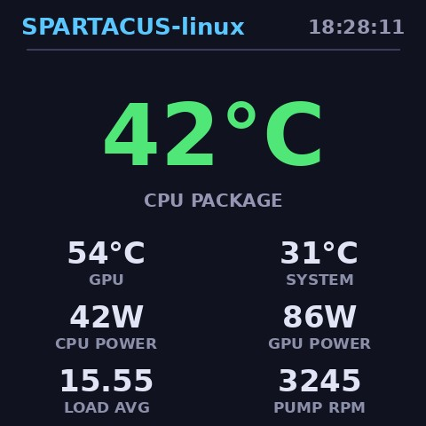

# SPARTACUS-linux

Linux-native driver + web console for the **DeepCool ICE BINGYU (冰暴) series**
AIO liquid cooler LCD screen (USB `3633:0027`, 480×480 round-ish square panel).

The panel ships with a Windows-only application. On Linux the device appears as
an unclaimed vendor-specific USB peripheral. This project implements its
vendor JPEG push protocol from scratch and provides two daemons that make the
screen fully usable under Linux — live telemetry dashboards, your own images /
GIFs / videos, and an OSD information overlay, all managed from a built-in web
console.

```
 sensors (/sys/class/hwmon, RAPL)          your media files
        │                                        │
        ▼                                        ▼
  spartacusd.py ──── settings.json ──── spartacus_web.py  (Flask, :8085)
  (renders 480×480 JPEG frames           (upload / transcode / crop /
   and pushes them over USB bulk          dashboard & overlay config,
   endpoints per the protocol)            media library, web UI)
        │
        ▼
 USB 3633:0027  (480×480 LCD)
```

Dashboard mode running on real hardware:



## Features

- **Dashboard mode** — configurable cards: CPU temperature (big number),
  GPU / motherboard temperature, **CPU package power (Intel RAPL)**,
  **GPU power (amdgpu PPT)**, CPU usage, load average, pump & fan RPM, clock.
- **Media mode** — upload **images** (jpg/png/webp/bmp), **GIFs** (original
  frame durations preserved) and **videos** (mp4/mkv/webm/mov/avi, transcoded
  to a JPEG frame cache with adaptive 4–12 fps).
- **Non-destructive crop framing** — a WYSIWYG editor in the browser
  (drag to pan, wheel/slider to zoom, square window = the 480×480 screen).
  The original upload is always kept; crops are parameters, so you can
  re-frame or reset at any time. Works for images, GIFs *and* videos
  (video crops re-transcode from the source file).
- **OSD overlay** — float live telemetry (temperatures, power, usage, RPM,
  clock) on top of any playing media: 6 positions, 3 font sizes,
  10 selectable items, semi-transparent rounded panel with stroked text.
- **Anti burn-in screensaver mode** — a standalone, 15 fps mode where the
  picture changes every frame so pixels age evenly: bouncing logo that
  swaps color on wall hits (DVD-style), flowing HSV gradient, or a
  starfield with slowly drifting nebulae and per-star breathing
  brightness. Clock + CPU-temp badge patrols all four corners (with
  crossfade transition) while micro-jittering every frame — no pixel
  stays lit.
- **Hot reload** — the push daemon watches the settings file; changes from
  the web console take effect within a second, no restart.
- **Robust** — auto-reconnects to the device, systemd-managed, survives
  crashes and reboots.

## Tested hardware / environment

| Item | Value |
|---|---|
| Device | DeepCool ICE BINGYU AIO LCD, USB `3633:0027` (4 EPs, bulk, 512 B) |
| Host | Ubuntu 24.04 LTS, kernel 6.x, x86_64 |
| CPU power source | Intel RAPL (`/sys/class/powercap/intel-rapl:0`) — needs root |
| Other sensors | `coretemp`, `amdgpu`, `nct6798` via `/sys/class/hwmon` |
| Rendering | Python 3 + Pillow |

Other Bingyu-family devices (`3633:0026` LT/LS 320×240 RGB565 etc.) use a
*sibling but different* protocol variant and are not covered by this driver —
see the references in [NOTICE](NOTICE).

## Requirements

```bash
sudo apt install python3 python3-flask python3-pil ffmpeg python3-usb
#   flask  → web console      pil   → rendering & media decoding
#   ffmpeg → video transcoding (optional, images/GIFs work without it)
#   python3-usb (pyusb) → device transport
```

## Installation

```bash
sudo install -m 755 src/spartacusd.py     /usr/local/bin/spartacusd.py
sudo install -m 755 src/spartacus_web.py  /usr/local/bin/spartacus_web.py

sudo mkdir -p /etc/spartacusd /var/lib/spartacus/media
# minimal settings (the web console writes this file later):
echo '{"mode":"dashboard","media":null}' | sudo tee /etc/spartacusd/settings.json

sudo install -m 644 systemd/spartacusd.service    /etc/systemd/system/
sudo install -m 644 systemd/spartacus-web.service /etc/systemd/system/
sudo systemctl daemon-reload
sudo systemctl enable --now spartacusd spartacus-web
```

If the device is currently passed through to a VM, take it back first
(`virsh detach-device <vm> <hostdev.xml> --live`) and make sure nothing else
holds it (`lsusb`, kernel driver is detached automatically by the daemon).

Open the console at **http://<host>:8085** (LAN). The web server has no
authentication — keep it on a trusted network or front it with a reverse proxy.

## Using the web console

1. **Dashboard** — tick the cards you want, set a title, apply. The screen
   updates immediately (≈2 fps).
2. **Media library** — upload an image / GIF / video, then *Play*.
   Thumbnails and metadata (frames, fps, duration) are shown per item.
3. **Framing** — the editor loads the untouched original. Pan/zoom inside the
   square guide (that is exactly what the 480×480 panel will show), then
   *Apply framing*. *Reset original* restores the un-cropped version.
4. **OSD overlay** — enable it, pick a corner/edge position and font size,
   and select which live values float over the media. Applies to images,
   GIFs and videos alike; values refresh every frame.
5. Delete items at any time; deleting the currently playing item falls back
   to the dashboard.

Data lives under `/var/lib/spartacus/media/<id>/` (`_src` original,
`manifest.json` with crop parameters, `f#####.jpg` render frames).

## Swapping the screen between Linux and Windows

`scripts/to-win.sh` / `scripts/to-linux.sh` are small libvirt helpers
(stop daemon → `attach-device`, detach → start daemon). Adjust the VM name,
the hostdev XML (`scripts/spartacus-aio.xml.example`) and run them on the host.

## Protocol

The panel speaks a vendor-specific **JPEG push protocol** over bulk USB: a
short session-init packet, followed by 512-byte framed blocks that carry the
JPEG payload together with length, checksum and block-count fields which the
device firmware validates on every frame. A continuous low-rate push (≈2 fps)
keeps the display session alive (the screensaver mode pushes faster, at 15
fps). The driver implements the whole data path itself, with no vendor
software, SDK or firmware involved.

## Related projects

We stand on the shoulders of these community projects (verified against their
repositories; no code copied, see [NOTICE](NOTICE)):

- [Mr-Pian/Deepcool-Bingyu-serise-software-for-linux](https://github.com/Mr-Pian/Deepcool-Bingyu-serise-software-for-linux)
  — *Deepcool Bingyu software for Linux*, a simple Python program for the
  sibling `3633:0026` (LT/LS, 320×240 RGB565) panel family. License: **MIT**
  (per the repository). It was consulted to understand protocol-family
  behaviour on Linux; our driver for the `3633:0027` panel is a separate,
  independent implementation.
- [liquidctl/liquidctl](https://github.com/liquidctl/liquidctl) —
  cross-platform CLI and Python drivers for AIO liquid coolers and other
  devices, including several DeepCool models. License: **GPL-3.0**
  (per the repository). Consulted as general background on DeepCool USB
  peripherals; no code copied or linked.

See [NOTICE](NOTICE) for the full attribution and dependency list.

## Disclaimer

This project is provided for **research, education and interoperability
purposes only** — its goal is to make an already-purchased device usable on
Linux. It is an independent community effort: not affiliated with, licensed
by, sponsored by, or endorsed by DeepCool.

- Hardware interaction (raw USB writes, sensor access) is performed **at
  your own risk**. The authors accept no liability for any damage to, loss
  of function of, or data loss on any device resulting from use or misuse
  of this software, including voiding of manufacturer warranties.
- Use of this project or of its documented findings for commercial purposes
  or any other purpose beyond research and interoperability is at the
  user's own discretion; any resulting legal, commercial or operational
  risk belongs to the user and is unrelated to this project and its authors.
- The protocol was derived empirically on one device revision. Manufacturer
  firmware updates or product revisions may change behaviour at any time.

The software is provided **AS IS** with absolutely no warranty (MIT, see
[LICENSE](LICENSE)). If the manufacturer requests removal or modification
of documentation or implementation details, we are open to cooperating —
please open an issue.

## License

MIT © 2026 The SPARTACUS-linux Authors. See [LICENSE](LICENSE) and
[NOTICE](NOTICE). Not affiliated with DeepCool.
