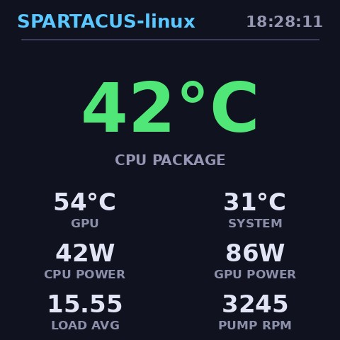

# SPARTACUS-linux（中文）

[English README](README.md) | **简体中文**

**九州风神 冰暴（DeepCool ICE BINGYU）系列一体式水冷 LCD 屏幕**的 Linux 原生驱动 +
网页控制台（USB `3633:0027`，480×480 面板）。

这块屏幕官方只有 Windows 软件；在 Linux 下它只是一个无人认领的 vendor-specific USB
外设。本项目从零实现了它的 JPEG 推流私有协议，并提供两个守护进程，让屏幕在 Linux
上完全可用——实时硬件仪表盘、自定义图片/GIF/视频播放、悬浮信息层（OSD），全部通过内置
网页控制台管理。

```
 传感器(/sys/class/hwmon, RAPL)             你的媒体文件
        │                                        │
        ▼                                        ▼
  spartacusd.py ──── settings.json ──── spartacus_web.py   (Flask, :8085)
  (渲染 480×480 JPEG 帧，                (上传/转码/取景裁剪、
   按协议经 USB bulk 端点推送)            仪表盘与悬浮层配置、媒体库)
        │
        ▼
 USB 3633:0027  (480×480 LCD)
```

真机上的仪表盘模式：



## 功能特性

- **仪表盘模式** — 卡片自由勾选：CPU 温度（大数字）、GPU/主板温度、
  **CPU 封装功率（Intel RAPL）**、**GPU 功率（amdgpu PPT）**、CPU 使用率、
  负载均值、水泵与风扇转速、时钟。
- **媒体模式** — 上传**图片**（jpg/png/webp/bmp）、**GIF**（保留原始帧间隔）、
  **视频**（mp4/mkv/webm/mov/avi，自适应 4–12 fps 转成 JPEG 帧缓存）。
- **非破坏式取景裁剪** — 浏览器内所见即所得编辑器：拖动平移、滚轮/滑条缩放，
  方形取景框就是屏幕的 480×480。上传的原始文件永远保留，裁剪只是参数，可随时换位置
  重裁或一键还原；图片、GIF、视频全部支持（视频从源文件重新转码，画质不降级）。
- **OSD 悬浮层** — 播放任何媒体时在画面上叠加实时数据（温度/功率/使用率/转速/时钟）：
  6 种位置、3 档字号、10 个显示项随意勾选，半透明圆角面板 + 描边白字。
- **防烧屏屏保模式** — 独立模式，画面逐帧变化让像素均衡老化：弹跳 Logo（撞边
  换色，经典 DVD 风）、流动渐变、漂移星空三种样式；可选角标时钟，位置持续
  微动避免残影。
- **热更新** — 推送 daemon 监视配置文件，网页改动 1 秒内生效，无需重启。
- **稳定** — USB 断开自动重连，systemd 托管，崩溃自愈、开机自启。

## 已验证环境

| 项目 | 值 |
|---|---|
| 设备 | DeepCool 冰暴 AIO LCD，USB `3633:0027`（4 端点，bulk，512B） |
| 系统 | Ubuntu 24.04 LTS，kernel 6.x，x86_64 |
| CPU 功率 | Intel RAPL（`/sys/class/powercap/intel-rapl:0`），需要 root |
| 其他传感器 | `coretemp`、`amdgpu`、`nct6798`（`/sys/class/hwmon`） |
| 渲染 | Python 3 + Pillow |

同家族的 `3633:0026`（LT/LS，320×240 RGB565 裸帧）是**同族但不同**的协议变体，
本驱动不覆盖；相关背景见 [NOTICE](NOTICE) 中的引用声明。

## 依赖安装

```bash
sudo apt install python3 python3-flask python3-pil ffmpeg python3-usb
#   flask → 网页控制台    pil → 渲染与图片/GIF 解码
#   ffmpeg → 视频转码（可选，图片/GIF 无它也能用）
#   python3-usb (pyusb) → USB 传输
```

## 部署

```bash
sudo install -m 755 src/spartacusd.py     /usr/local/bin/spartacusd.py
sudo install -m 755 src/spartacus_web.py  /usr/local/bin/spartacus_web.py

sudo mkdir -p /etc/spartacusd /var/lib/spartacus/media
# 最小配置（之后由网页控制台改写此文件）：
echo '{"mode":"dashboard","media":null}' | sudo tee /etc/spartacusd/settings.json

sudo install -m 644 systemd/spartacusd.service    /etc/systemd/system/
sudo install -m 644 systemd/spartacus-web.service /etc/systemd/system/
sudo systemctl daemon-reload
sudo systemctl enable --now spartacusd spartacus-web
```

若设备当前被直通给虚拟机，先收回（`virsh detach-device <vm> <hostdev.xml> --live`）。
内核驱动由 daemon 自动 detach，无需手工处理。

浏览器打开 **http://<主机>:8085**（局域网）。网页服务没有鉴权——请保持在可信网络内，
或自行架一层反向代理。

## 网页控制台用法

1. **仪表盘** — 勾选要显示的卡片、自定义标题、应用，屏幕立即更新（约 2 fps）。
2. **媒体库** — 上传图片/GIF/视频，点「播放」。每个条目显示缩略图与参数（帧数/fps/时长）。
3. **取景** — 编辑器加载的永远是未裁剪的原始文件；在方形取景框内平移缩放（框即屏幕），
   点「应用取景」；「还原原始」恢复未裁剪版本。
4. **OSD 悬浮层** — 启用后选择角落/边位置与字号，勾选要叠加的实时数据。图片、GIF、
   视频一律生效，数值逐帧刷新。
5. 删除条目随意；删除正在播放的条目会自动回到仪表盘。

数据存放在 `/var/lib/spartacus/media/<id>/`（`_src` 原始文件、`manifest.json`
含裁剪参数、`f#####.jpg` 为上屏帧缓存）。

## Linux ↔ Windows 切换屏幕

`scripts/to-win.sh` / `scripts/to-linux.sh` 是 libvirt 小助手（停 daemon →
`attach-device`；detach → 起 daemon）。按你的环境改虚拟机名与 hostdev XML
（模板见 `scripts/spartacus-aio.xml.example`），在宿主机执行即可。

## 协议

屏幕走的是厂商私有的 **JPEG 推流协议**（bulk USB）：一个简短的会话初始化报文，
随后是以 512 字节块封装的 JPEG 载荷；固件对每帧核对声明长度、校验和与块数，
任一不符即静默丢弃整帧。需要持续低频推送（约 2 fps）以维持显示会话。
驱动自行实现了完整数据通路，全程不依赖任何厂商软件、SDK 或固件。

## 相关项目

我们站在这些社区项目的基础上（以下信息均已对照其仓库核实；未复制任何代码，
详见 [NOTICE](NOTICE)）：

- [Mr-Pian/Deepcool-Bingyu-serise-software-for-linux](https://github.com/Mr-Pian/Deepcool-Bingyu-serise-software-for-linux)
  —— 面向同族 `3633:0026`（LT/LS，320×240 RGB565）面板的 Linux 简易 Python
  程序。许可证：**MIT**（据其仓库）。本项目仅参考其对协议族行为的理解；
  本驱动是针对 `3633:0027` 面板的独立实现。
- [liquidctl/liquidctl](https://github.com/liquidctl/liquidctl) ——
  跨平台的一体式水冷及多种设备 CLI/Python 驱动（含部分 DeepCool 型号）。
  许可证：**GPL-3.0**（据其仓库）。仅作为 DeepCool USB 外设的一般背景参考；
  未复制或链接其代码。

完整引用与第三方许可声明见 [NOTICE](NOTICE)（英文）。

## 免责与使用限制声明

本项目仅限于**研究、学习与互操作性目的**（让已经购买的设备能够在 Linux
下正常使用），为独立社区工作：与九州风神（DeepCool）**无隶属关系、未获授权、
未获赞助或背书**。

- 硬件交互（USB 原始写入、传感器访问）**风险自负**。作者对因使用或误用本
  软件造成的任何设备损坏、功能丧失、数据丢失不承担责任，亦不代为处理由此
  引起的厂商保修问题。
- 将本项目或其文档所述结论用于商业目的，或用于研究/互操作之外的任何其他目的，
  由使用者自行判断并承担全部后果；由此产生的法律、商业与运营风险均与本
  项目及作者无关。
- 协议结论来自单一设备批次的实测观察；厂商固件升级或产品改版可能随时改变
  设备行为。

本软件按 **现状（AS IS）** 提供，完全没有任何形式的担保（MIT，见
[LICENSE](LICENSE)）。如厂商要求移除或修改文档中的实现细节，我们愿意积极配合，
欢迎提交 issue 联系。

## 许可

MIT © 2026 The SPARTACUS-linux Authors。见 [LICENSE](LICENSE)。
本项目与九州风神（DeepCool）无隶属关系。
